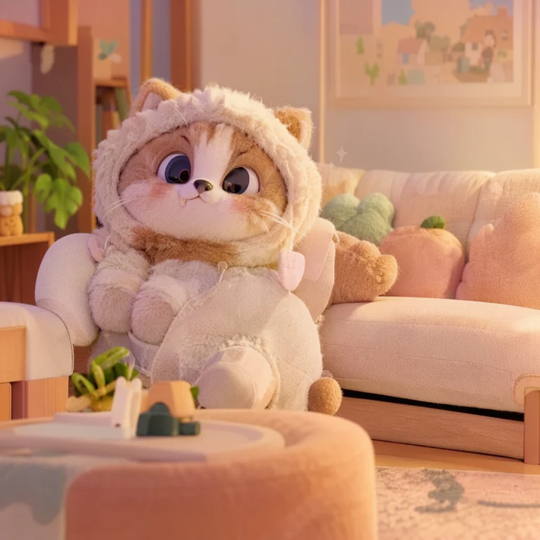
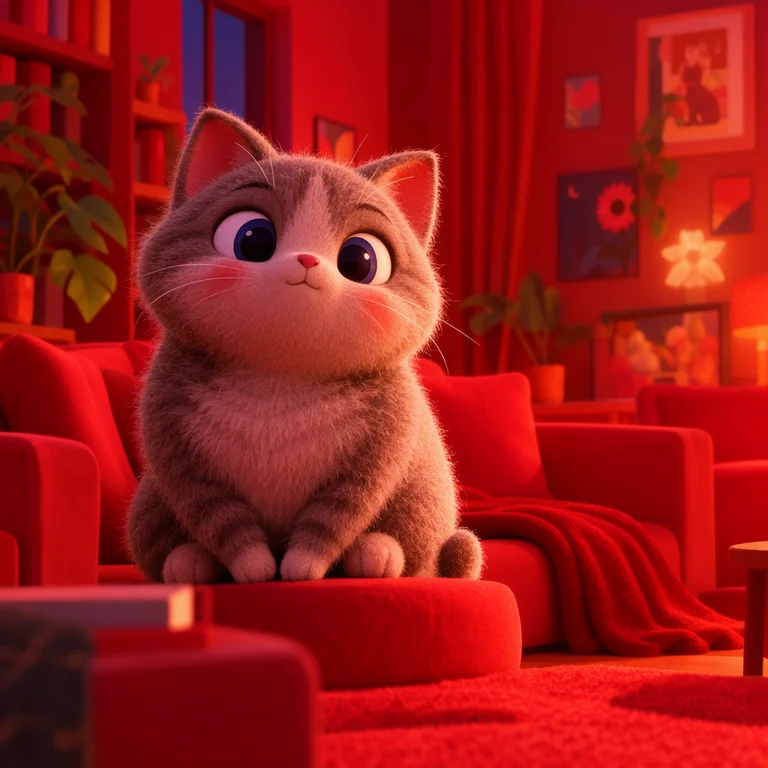
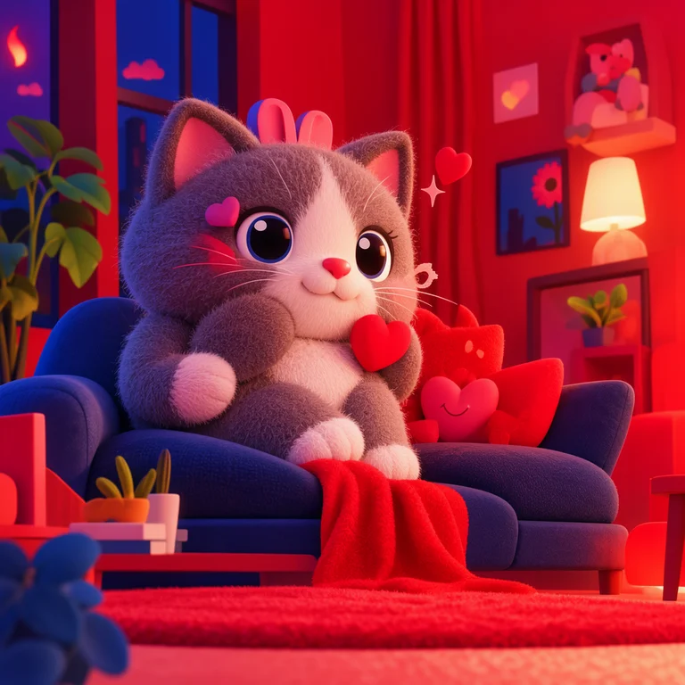
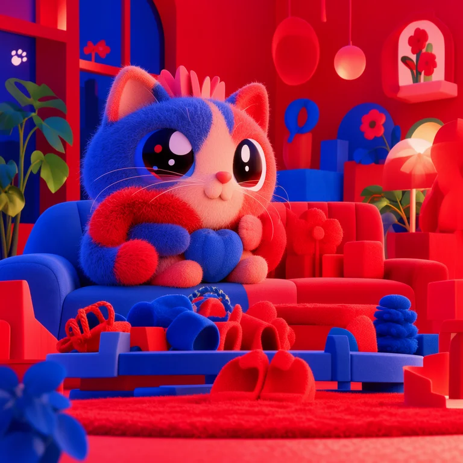
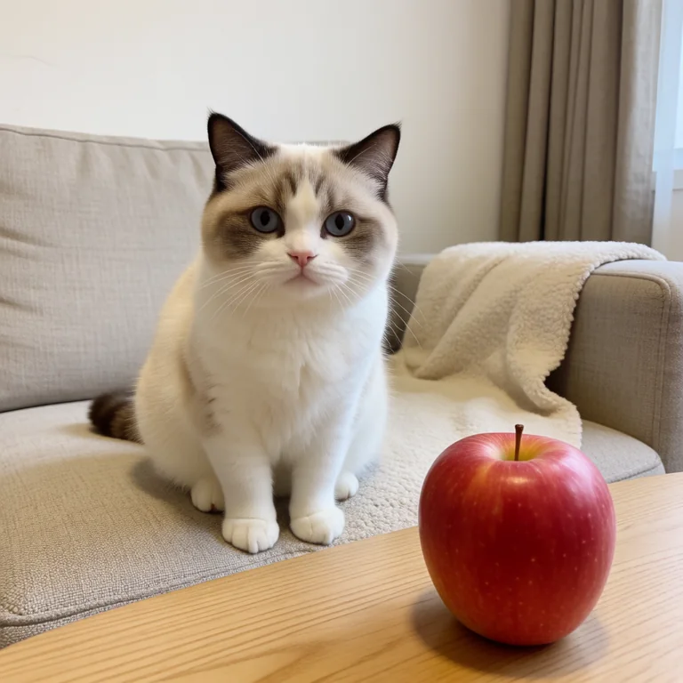
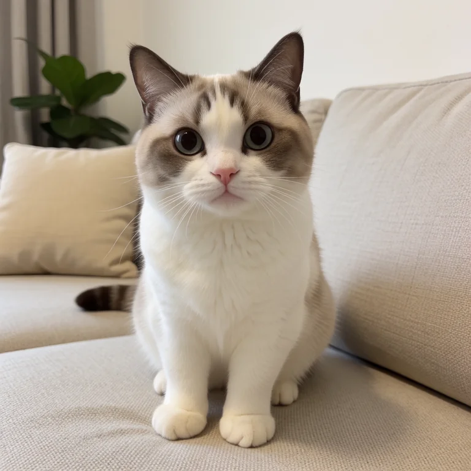
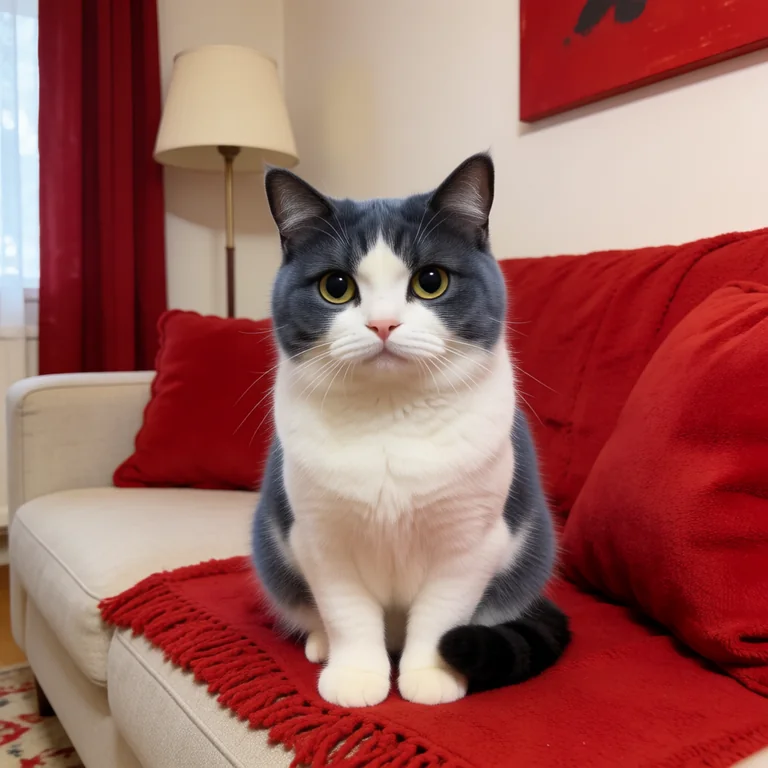
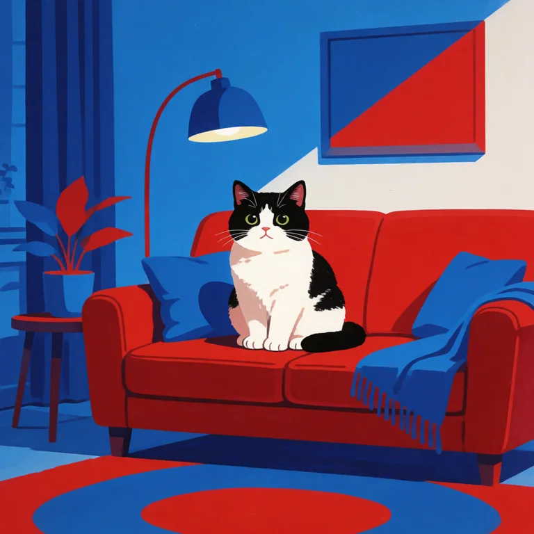

# NegPiP / Prompt Weighting for Forge Neo (Krea 2, MOSS-Image, Anima, SD1, SDXL)

A personal, AI-assisted fork of [Haoming02's sd-forge-negpip](https://github.com/Haoming02/sd-forge-negpip) for Forge Neo. It adds NegPiP and prompt weighting for Krea 2 (Krea2) and MOSS-Image, which may help when prompt weights such as `(word:1.5)` or `(word:-1.0)` have little or no visible effect, and it keeps the NegPiP support for **SD1, SDXL, and Anima**. See [Krea 2 Prompt Weighting](#krea-2-prompt-weighting) and [MOSS-Image Prompt Weighting](#moss-image-prompt-weighting).

> [!NOTE]
> This is not an official implementation. It was developed largely with AI assistance for my own use and is shared in case it helps someone with the same problem. Haoming02's sd-forge-negpip was archived on 2026-09-30, so this fork is where the Forge Neo version continues. The original [sd-webui-negpip](https://github.com/hako-mikan/sd-webui-negpip) also supports Krea 2 (since 2026-09-04) and MOSS-Image (since 2026-10-25, Forge Neo's built-in MOSS-Image support only) on Forge Neo; prefer it if negative weights are all you need, as this fork additionally applies positive weights such as `(word:1.5)`. The two extensions work differently and read the weight on a different scale, so the same prompt does not give the same image; see [Differences from the original sd-webui-negpip](#differences-from-the-original-sd-webui-negpip).

## Features

- Negative prompt weights inside the positive prompt, even when using Krea 2 at CFG 1
- Optional **V-Scaling**, which scales the attention values (V) of weighted tokens, for more noticeable positive and negative Krea 2 prompt weights
- The same NegPiP weighting and V-Scaling for MOSS-Image, which otherwise ignores prompt weights entirely, with Forge Neo's own MOSS-Image support as well as the moss-image-forge-neo extension
- NegPiP behavior for SD1, SDXL, and Anima inherited from the original extension
- Forge Neo integration for txt2img and img2img

## Installation

In Forge Neo, open **Extensions → Install from URL** and enter:

```text
https://github.com/flyfront/sd-forge-negpip
```

No branch name is required: `neo` is the default branch and covers every supported model, including MOSS-Image. Install the extension and restart the web UI.

If you installed this extension earlier on the `neo-krea2-emphasis` branch, nothing changes: that branch is kept as a mirror of `neo` and keeps receiving the same commits. The `neo-moss` branch (where the MOSS-Image support was developed) and the older `neo-krea2` branch (NegPiP without V-Scaling) are frozen; switch to `neo` with `git switch neo` inside `extensions/sd-forge-negpip` to keep getting updates.

The V-Scaling accordion is labeled **NegPiP V-Scaling** (it was **NegPiP V-Scaling (Krea 2)** before 2026-10-22); the models it applies to are listed in the Strength slider's description. The label is also the `ui-config.json` key, so a default you saved there under the old label has to be set again.

## How to Use

- add `(foo:-1.0)` in the `positive prompt` to **remove** a concept
- add `(bar:-1.0)` in the `negative prompt` to **enforce** a concept
- For Krea 2 and MOSS-Image, open **NegPiP V-Scaling** and use a positive weight such as `(word:1.5)` for stronger emphasis

## Krea 2 Prompt Weighting

Forge Neo's built-in prompt weighting does not work as intended on Krea 2. It scales the input embeddings, which the text encoder's normalization largely cancels, so a weight such as `(word:1.5)` does not make the word stronger; the weighted prompt may still render noticeably differently, just not in the intended direction. This experimental fork adds NegPiP-style weighting: negative weights such as `(word:-1.0)` can suppress concepts, just like NegPiP on the other models. Positive weights such as `(word:1.5)` are also applied, but they may be much less visible than negative weights because Krea 2 tends to normalize away simple magnitude changes.

The extension additionally offers an optional stronger mode: enable the **NegPiP V-Scaling** accordion on the txt2img / img2img page, and the prompt weight directly scales the attention values (V) of the weighted tokens, i.e. how much each token contributes inside the model, making both positive and negative weights more noticeable. The **Strength** slider runs from the normal behavior (`0`) to the raw prompt weight (`1`); values up to `2` strengthen the magnitude using a sign-preserving power curve, so weights never flip from emphasis to suppression or vice versa. Since this changes the image considerably, use it only when you need it; the strength is recorded in the infotext as `NegPiP V-Scaling` while it is on. With the accordion off, the extension behaves like the plain NegPiP-style weighting described above.

- The extension activates whenever any non-unit weight is present in the prompts, not just negative weights; the activation is recorded as `NegPiP: True` in the infotext
- Krea 2 has no chunking and `BREAK` is not treated specially, same as without this extension; note that the prompt parser internally marks `BREAK` with a weight of `-1`, so a bare `BREAK` behaves like `(BREAK:-1.0)` while the extension is active
- When Krea 2 Reference is active with a reference image, the positive prompt uses Forge Neo's image-aware conditioning path and NegPiP weighting is disabled for that positive prompt. Negative-prompt NegPiP remains available. The console reports `NegPiP Positive Disabled (Krea 2 Reference active)` in this case

> [!NOTE]
> The Krea 2 support is based on [ComfyUI-krea2-negpip](https://github.com/blue-pen5805/ComfyUI-krea2-negpip). Following that implementation, weighted prompts are tokenized with the chat template applied once around the entire prompt, rather than once per weighted segment like the built-in emphasis does, and weight magnitudes are applied on the text encoder output by interpolating each weighted token between a neutral (empty) encoding and its actual encoding. Since Krea 2 uses normalization heavily, positive weights mostly affect the remaining directional difference and can look subtle, while negative weights additionally flip the token direction in attention values and tend to be much more noticeable. As V-Scaling rises from `0` to `1`, the encoder-side interpolation fades out continuously (large extrapolated weights can drift the token embedding away from its meaning), while the attention values (V) take over the magnitude using `sign(weight) × abs(weight) ** Strength`. V is the only tensor in the attention that Krea 2's normalization does not touch, so the token keeps its meaning while its contribution scales, and weights gain gradation on both sides, e.g. `(word:-2.0)` suppresses more strongly than `(word:-1.0)`. The scaled values are only read by the image tokens; the text tokens keep reading the original sign mask, so the text stream stays intact even at large weights (mirroring how NegPiP works in cross-attention models). Weighted prompts render differently from extension-off.

## MOSS-Image Prompt Weighting

MOSS-Image comes to Forge Neo in two ways: Forge Neo's own support (since [Haoming02/sd-webui-forge-classic#1564](https://github.com/Haoming02/sd-webui-forge-classic/pull/1564), merged 2026-10-21) and the earlier [moss-image-forge-neo](https://github.com/eduardoabreu81/moss-image-forge-neo) extension. Both pass the prompt to the Qwen3.5-9B text encoder verbatim, so prompt weights such as `(word:1.5)` or `(word:-1.0)` are not even parsed: the parentheses and the number reach the text encoder as text. This extension detects which implementation loaded the model and hooks its text engine and DiT the same way as for Krea 2; there is nothing to configure:

- Weighted prompts are parsed with Forge Neo's prompt parser (the `Emphasis` setting applies), tokenized with the MOSS-Image chat template once around the whole prompt, and the weighted segments are tokenized so that they produce the same tokens as the plain prompt
- Weight magnitudes are applied through Forge Neo's ComfyUI-compatible text encoder path (which both implementations use), interpolating each weighted token between the empty encoding and its own, i.e. the standard ComfyUI prompt weighting
- Negative weights flip the sign of the token's attention values (V) in all 42 joint blocks of the DiT; the text-only refinement blocks are left alone. The optional **V-Scaling** works like on Krea 2: the image tokens read `sign(weight) × abs(weight) ** Strength`, the text tokens read the sign only
- A prompt without effective weights is encoded exactly as the implementation does on its own
- In a layout prompt (a JSON object, e.g. written by [Regional Boxes](https://github.com/eduardoabreu81/sd-regional-boxes-neo) or Forge Neo's JSON Builder), weights are read only inside the captions (the scene `caption` and each item's `caption`); the words to render (`text`), `meta` and the boxes are data and stay verbatim, so the brackets of a box never count as emphasis. Plain prompt text after the layout (the JSON Builder's `Extra` field) is weighted as usual. A layout without weights is passed through untouched and does not activate the extension
- `BREAK` is a plain word for MOSS-Image; while NegPiP is active it stays a plain word
- The negative-prompt block skipping keeps working, both the extension's (`[MOSS-Image] Blocks skipped in the negative-prompt pass`) and Forge Neo's Skip Layer Guidance
- The few-step distilled LoRAs work too (verified with lodestones' 8-step DMD LoRA and akhaliq's 4-step LoRA at CFG 1): `(word:-1.0)` in the positive prompt still removes the concept. Since those LoRAs run at CFG 1, the negative prompt is not evaluated, so weights in the negative prompt have no effect there

Both paths were verified with the MOSS-Image SFT model (`moss_image_sft_int8_convrot`): the extension path on Forge Neo 2.30 with moss-image-forge-neo 0.1.1 (and offline against 0.1.2), the Forge Neo path on the #1564 branch as of 2026-10-22 (with Skip Layer Guidance on), with matching results. If neither implementation is recognized or its internals change, NegPiP stays off for MOSS-Image and prints `NegPiP Disabled (MOSS-Image: ...)` to the console; the model keeps working.

## Differences from the original sd-webui-negpip

The original [sd-webui-negpip](https://github.com/hako-mikan/sd-webui-negpip) by hako-mikan supports Z-Image, Anima, Krea 2 and MOSS-Image (Forge Neo's built-in support only) on Forge Neo. This fork descends from Haoming02's port, which took a different approach for the newer architectures, so on Krea 2 and MOSS-Image the two extensions behave differently even for the plain `(word:-1.0)` case. Do not install both at once; disable one in the Extensions tab when comparing.

- Method: the original removes `(word:-1.0)` from the prompt, encodes the word on its own, appends those tokens to the conditioning and flips their attention values. This fork keeps the word in the prompt and flips the attention values at its own token positions (the position-mask method Haoming02's version introduced for Anima). As a result, the rest of the prompt is encoded unchanged here and the composition stays close to the image without the weight, while the original changes the token sequence itself and the composition shifts with it. On the other hand, the original's word is never seen by the surrounding text, whereas here the text encoder still reads the word in context, so some of the concept can remain in the following words; a negated attribute such as `(red:-1.0) apple` may come out cleaner with the original
- Scale of the weight: since 2026-09 the original multiplies the attention values by the weight on these models, so `-2` is stronger than `-1` and around `-3` the whole picture changes (per its README). In this fork, with V-Scaling off, only the sign of the weight counts on Krea 2 and MOSS-Image: `-0.5`, `-1` and `-2` give the same image, and `(word:1.5)` is applied as the plain weighting described above. For gradation, enable **NegPiP V-Scaling**; the image tokens then read `sign(weight) × abs(weight) ** Strength`, while the text tokens keep reading the sign only, so large weights degrade the image less than in the original, and the numbers are not interchangeable between the two
- Positive weights: the original does not apply them on these models; `(word:1.5)` reaches the text encoder as it would without the extension. This fork applies them (see the Krea 2 and MOSS-Image sections)
- SD1 and SDXL keep the original's method and scale in this fork, so there `(word:-2.0)` is twice as strong as `(word:-1.0)`, as in the original
- What is the same: at exactly `-1.0` on MOSS-Image both extensions perform the same operation, flipping the attention values in the joint blocks and leaving the text-only blocks alone, so the word is removed in both; on Krea 2 a side-by-side run at `-1.0` gave comparable results. The two have not been compared side by side on MOSS-Image

## Examples

### MOSS-Image

Generated with `moss_image_sft_int8_convrot` on Forge Neo 2.30 (Euler, MOSS schedule, 20 steps, CFG 3.0, 1024×1024, same seed).

<table>
    <tr>
        <th>Base</th>
        <th><code>(a red apple:-1.0)</code><br>in <b>Positive</b> Prompt</th>
    </tr>
    <tr>
        <td></td>
        <td></td>
    </tr>
</table>

```
a cute cat sitting on a sofa in a living room, a red apple on the table
```

<table>
    <tr>
        <th>This extension <b>disabled</b></th>
        <th>V-Scaling <b>off</b></th>
        <th>V-Scaling <b>on</b> (Strength 1.0)</th>
    </tr>
    <tr>
        <td></td>
        <td></td>
        <td></td>
    </tr>
</table>

```
a cute cat sitting on a sofa in a living room, red theme, (blue theme:2.0)
```

With this extension disabled, the MOSS-Image extension receives `(blue theme:2.0)` as plain text and the room comes out entirely red. With NegPiP-style weighting, blue gets a visible push; with V-Scaling on, blue wins.

### Krea 2

Generated with `krea2_turbo_fp8_scaled` on Forge Neo 2.29 (Euler, 8 steps, CFG 1.0, 1024×1024, same seed).

<table>
    <tr>
        <th>Base</th>
        <th><code>(television:-1.0)</code><br>in <b>Positive</b> Prompt</th>
    </tr>
    <tr>
        <td></td>
        <td></td>
    </tr>
</table>

```
a cute cat sitting on a sofa in a living room
```

<table>
    <tr>
        <th>V-Scaling <b>off</b></th>
        <th>V-Scaling <b>on</b> (Strength 1.0)</th>
    </tr>
    <tr>
        <td></td>
        <td></td>
    </tr>
</table>

```
a cute cat sitting on a sofa in a living room, red theme, (blue theme:2.0)
```

With V-Scaling off, the positive weight barely changes the red-dominated result. With V-Scaling on, blue wins the tug-of-war, and the overall rendering changes as well, as described above.

### SD1 / SDXL / Anima

> [!NOTE]
> These example images and prompts are inherited from the upstream extension and were not generated with Krea 2. They demonstrate the original NegPiP behavior. The third image uses a weight in the negative prompt, which has no effect on Krea 2 turbo models at CFG 1 because Forge Neo skips the negative prompt there.

<table>
    <tr>
        <th>Base</th>
        <th><code>(aqua hair:-1.0)</code><br>in <b>Positive</b> Prompt</th>
        <th><code>(aqua hair:1.5)</code><br>in <b>Negative</b> Prompt</th>
    </tr>
    <tr>
        <td></td>
        <td></td>
        <td></td>
    </tr>
</table>

- **Full Prompts**

```
masterpiece, best quality, high quality, 1girl, solo, hatsune miku, vocaloid, casual, looking at viewer, smile, simple background, white background,
anime screenshot, anime coloring, screencap, flat color, masterpiece, best quality, very aesthetic, absurdres, aesthetic, detailed, beautiful color, amazing quality, highres, safe
Negative prompt: (signature), worst quality, bad quality, low quality, text, name, watermark, (hdr, cinematic, high contrast), logo, username, bad anatomy, bad proportions, extra limbs, extra digit, extra legs, extra legs and arms, disfigured, missing arms, too many fingers, fused fingers, missing fingers, unclear eyes, censored
```
